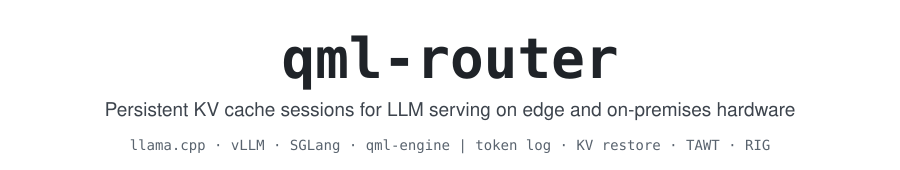
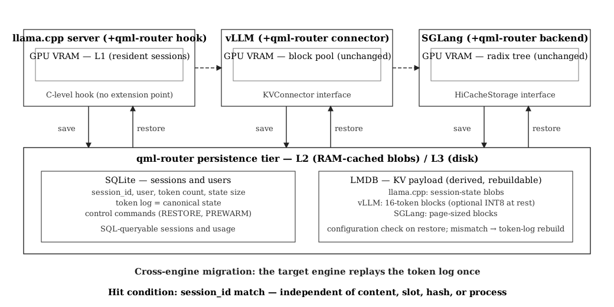
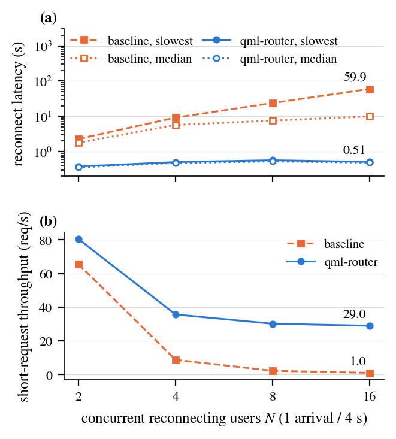
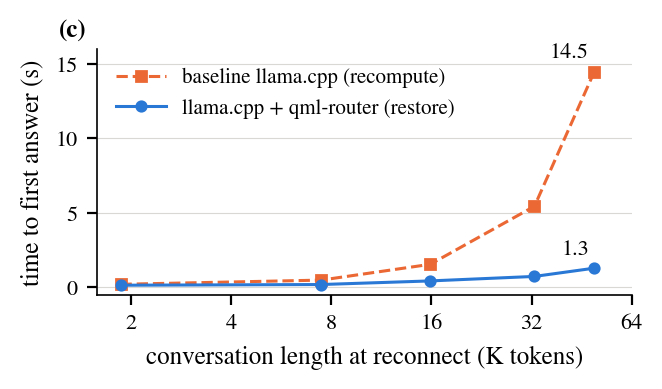
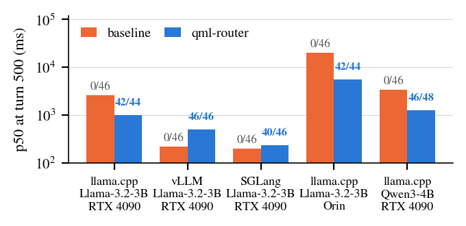

<!--
SPDX-License-Identifier: AGPL-3.0-only
Copyright (c) 2026 Korea Platform Service Technology Co., Inc. All rights reserved.
-->

<p align="center">
  <picture>
    <source media="(prefers-color-scheme: dark)" srcset="docs/images/banner-dark.svg">
    
  </picture>
</p>

<p align="center">
  <a href="#license"></a>
  <a href="#paper"></a>
  
  
</p>

<p align="center">
  <a href="#how-it-works">How it works</a> ·
  <a href="#results">Results</a> ·
  <a href="#engines">Engines</a> ·
  <a href="#paper">Paper</a> ·
  <a href="#license">License</a>
</p>

---

**qml-router keeps a conversation's state outside the LLM serving process.** A session survives
process restarts, a reconnect restores the KV cache instead of recomputing it, history past the
context window is archived and retrieved when a question needs it, and a session can continue on
another engine. It targets resource-constrained hardware: on-premises servers and edge devices.

> [!NOTE]
> The source code, the benchmark programs and the paper's experiment artifact are published here
> after the final publication of the paper. Until then this repository holds the description, the
> license and the contribution terms.

<table>
  <tr>
    <td align="center" width="33%"><h2>4.6×</h2>faster 32K-token reconnect<br><sub>restore 0.66 s vs recompute 3.03 s · RTX 4090, NVMe</sub></td>
    <td align="center" width="33%"><h2>20.7×</h2>faster on an edge device<br><sub>4.2 s vs 87.9 s · Jetson AGX Orin, 30 W</sub></td>
    <td align="center" width="33%"><h2>20,000</h2>turns in one session<br><sub>no material increase in per-turn latency · Llama-3.3-70B, H200</sub></td>
  </tr>
</table>

## News

- **2026-10** · The paper on qml-router is accepted by *IEEE Access* ([Paper](#paper)).
- **2026-10** · This repository opens; the code follows the final publication.

## What it does

| | |
|---|---|
| **Identity-keyed persistence** | Session state is stored and looked up by session identity (`user::session`), not by content hash. |
| **Restore instead of recompute** | A reconnect loads the stored KV payload; the token log is the fallback when the payload does not match the engine configuration. |
| **TAWT** (turn-aligned window trim) | Past the window, whole turns move to a per-session archive without loss; the system prefix stays. |
| **RIG** (Recall Injection Gate) | Archived turns are indexed with SQLite FTS5 (BM25); a confidence gate and a token budget decide what to inject on a later turn. |
| **Cross-engine continuation** | A session continues on another engine by replaying the token log, given a shared tokenizer. |

The design rests on one invariant: the canonical state of a session is a token log owned by an
explicit identity; each engine's KV cache is a rebuildable acceleration derived from that log.

## How it works

```text
                            QML ROUTER
┌────────────────────────────────────────────────────────────────┐
│                        Client / Gateway                        │
│ OpenAI-compatible API │ new turn + session_id (user::session)  │
├────────────────────────────────────────────────────────────────┤
│                         Session Layer                          │
│ Identity │ Token Log │ Restore │ TAWT │ RIG (FTS5, BM25)       │
├────────────────────────────────────────────────────────────────┤
│                       Engine Integration                       │
│ llama.cpp server patch + hook                                  │
│ vLLM KVConnector │ SGLang HiCache backend                      │
├────────────────────────────────────────────────────────────────┤
│                             C Core                             │
│ TAWT policy (qml_window) │ RIG policy (qml_rig)                │
├────────────────────────────────────────────────────────────────┤
│             Embedded Store (in the engine process)             │
│ SQLite: session │ token log │ archive │ FTS5 index             │
│ LMDB: KV payload                                               │
└────────────────────────────────────────────────────────────────┘
```

**One turn of a session**

1. Look up the session by its identity.
2. If the stored KV matches the engine configuration, load it; otherwise replay the token log.
3. RIG searches this session's archive, gates the candidates and injects the chosen turns.
4. The engine generates the answer.
5. The turn is appended to the token log and the KV is saved.
6. Past the window, TAWT moves whole turns to the archive.

Storage is embedded in the serving process (SQLite and LMDB); there is no separate service.

<p align="center">
  
</p>

## Results

Llama-3.2-3B-Instruct unless noted; every reconnect answer is checked against a value planted in
its own history. Baseline = the same engine without qml-router.

<p align="center">
  
  
</p>

<sub>Left: N users reconnect at once (latency over passing answers only: 29/30 qml-router, 30/30
baseline; throughput not answer-checked). Right: one user's reconnect latency versus history length.</sub>

**32K-token reconnect by storage and device**

| Environment | Recompute | Restore | Ratio |
|---|---|---|---|
| RTX 4090, storage 0.55 GB/s (container) | 3.16 s | 2.24 s | 1.4× |
| Same GPU, NVMe 1.6-1.9 GB/s (host) | 3.03 s | 0.66 s | **4.6×** |
| Jetson AGX Orin, MAXN | 23.93 s | 2.26 s | 10.6× |
| Jetson AGX Orin, 30 W | 87.87 s | 4.24 s | **20.7×** |

Regimes where recomputation is as fast or faster (short histories on a fast GPU) are reported in
the paper.

<details>
<summary><b>Reconnect latency under load</b> (llama.cpp, RTX 4090)</summary>

| Condition | Baseline | qml-router | Ratio |
|---|---|---|---|
| 16 users reconnect at once: slowest / median reconnect | 59.9 s / 10.0 s | 0.51 s / 0.49 s | — |
| Same run: short-request throughput | 1.0 req/s | 29.0 req/s | 29× |
| One user, 49K-token history | 14.5 s | 1.3 s | 11× |
| 32K-token history, 10 runs (median) | 5.433 s | 0.760 s | 7.1× |
| 49K-token history, 10 runs (median) | 14.400 s | 1.329 s | 10.8× |

</details>

<details>
<summary><b>500-turn session past a 32K-token window</b> (facts answered at turn 500)</summary>

<p align="center">
  
</p>

| Engine and device | Baseline | qml-router | Throughput (turns/s), baseline -> qml-router |
|---|---|---|---|
| llama.cpp, RTX 4090 | 0/46 | 42/44 | 0.42 -> 0.49 |
| vLLM, RTX 4090 | 0/46 | 46/46 | 3.95 -> 1.49 |
| SGLang, RTX 4090 | 0/46 | 40/46 | 4.23 -> 2.53 |
| llama.cpp, Jetson AGX Orin | 0/46 | 42/44 | 0.06 -> 0.13 |
| llama.cpp, RTX 4090, Qwen3-4B | 0/46 | 46/48 | 0.32 -> 0.44 |

On vLLM and SGLang the baseline drops the history that passed the window and stays faster;
qml-router keeps the history and answers the questions about it.

</details>

<details>
<summary><b>Cost of adding qml-router</b> (RTX 4090, 12 sessions per run, 3 runs)</summary>

| Engine | GPU memory | Latency per request |
|---|---|---|
| llama.cpp | +0 MiB | 225 -> 252 ms (+27) |
| vLLM | +0 MiB | 180 -> 259 ms (+79) |
| SGLang | +47 MiB | 166 -> 185 ms (+19) |

</details>

<details>
<summary><b>Comparison with persistent-KV systems</b></summary>

✓ = supported, — = not provided, N/R = the cited work does not report the property (not taken as
evidence of its absence). Cells reflect the cited publications and, for LMCache, its 2026 public
documentation.

| System | Canonical state | Identity-keyed session | Restart persistence | Heterogeneous engines | Lossless overflow archive | Selective history retrieval | Process isolation boundary | Encryption at rest | Correctness verification |
|---|---|---|---|---|---|---|---|---|---|
| LMCache | KV bytes (content hash) | prefix-keyed chunks; tenant salt, no session identity | ✓ (standalone daemon) | vLLM, SGLang | — | — | out-of-process daemon (IPC per operation) | ✓ (persistent tier) | N/R |
| KVGov | KV bytes (content hash, principal salt) | prefix-keyed within a principal; no session identity | — | vLLM, llama.cpp | — | — | in-process (engine cache) | N/R | N/R |
| CachedAttention | KV bytes | session-oriented | ✓ (hierarchical store) | single engine | — | — | N/R | N/R | N/R |
| agent-memory | KV bytes (Q4) | prefix-keyed per agent (Q4 KV) | N/R | single runtime (MLX) | — | N/R | in-process (MLX runtime) | N/R | N/R |
| **qml-router** (llama.cpp, vLLM, SGLang) | token record; KV derived | ✓ (`user::session`) | ✓ | ✓ | ✓ (TAWT) | ✓ (RIG) | in-process store (trust boundary = process) | — (roadmap) | ✓ |

</details>

<details>
<summary><b>Models and hardware used in the experiments</b> (including experiments that are not in the paper)</summary>

| Device | Model (precision, format) | Engine | Experiments | In the paper |
|---|---|---|---|---|
| NVIDIA H200 (143 GB) | Llama-3.3-70B-Instruct Q8_0, GGUF | llama.cpp + qml-router | 20,000-turn session (27 questions); 2,000-turn weather recall (21 questions); LongMemEval_S archive recall (reader and judge); ranker accuracy; needle recall in a continuous session (90 questions); load tests | Section V-B1, Fig. 6, Table 13 (needle recall and load tests: no) |
| NVIDIA H200 | Llama-3.3-70B-Instruct FP8-dynamic, HF | vLLM 0.24.0, unmodified (retrieval in the client) | 2,000-turn weather recall (21/21); 20,000-turn session (27/27, stock 0/27); needle recall (88/90) | No |
| NVIDIA H200 | Llama-3.1-8B-Instruct BF16, HF and GGUF | llama.cpp, vLLM | Engine timing on identical weights; 20,000-turn session (llama.cpp 25/27, vLLM 27/27) | No |
| NVIDIA H200 | Llama-3.1-8B-Instruct Q8_0 and Llama-3.2-3B-Instruct F16, GGUF | llama.cpp + qml-router | 2,000-turn weather recall by reader size (3B, 8B, 70B) | No |
| NVIDIA H200 | Qwen3-32B Q8_0, GGUF | llama.cpp + qml-router | Adoption cost; 500-turn context overflow | No (removed from the paper) |
| NVIDIA H200 | bge-m3 F16, GGUF | llama.cpp (embedding) | Embedding retrieval and ranker latency | Fig. 6(a), Table 13 |
| RTX 4090 (24 GB) | Llama-3.2-3B-Instruct F16, GGUF, Q4_0 KV | llama.cpp + qml-router | Reconnect density and crossover; adoption cost; 500-turn context overflow; repeated runs; restore/recompute boundary; persistence window; layer-versus-engine attribution; write volume; 2,000-turn weather recall checks | Fig. 1, Tables 4-7, 14, Appendix A-E (weather recall checks: no) |
| RTX 4090 | Llama-3.2-3B-Instruct FP16, HF | vLLM 0.26.0, SGLang 0.5.16 | Adoption cost; 500-turn context overflow; mixed workload; cross-engine continuation; multi-turn session load (96 turns) | Tables 4, 5, 10, Fig. 5 (load: no) |
| RTX 4090 | Llama-3.1-8B-Instruct AWQ-INT4, HF | vLLM 0.26.0 (qml-router connector, LMCache 0.5.2), SGLang 0.5.16 | Identity-keyed versus content-keyed reuse (LMCache); mixed workload | Tables 10, 11 |
| RTX 4090 | Llama-3.1-8B-Instruct Q4_K_M, GGUF | llama.cpp | Mixed workload; restart resume | Table 10 (resume: no) |
| RTX 4090 | Llama-3.1-8B-Instruct Q8_0, GGUF | llama.cpp + qml-router | 20,000-turn session (25/27; 8/9 in one continuous session); retrieval selection comparisons | No |
| RTX 4090 | Qwen3-4B F16, GGUF, Q4_0 KV | llama.cpp + qml-router | Size-matched non-Llama check (adoption cost, 500-turn context overflow) | Section V-A2, Table 5 |
| RTX 4090 | gemma-3-4b-it, gemma-3-12b | vLLM 0.26.0, SGLang 0.5.16, llama.cpp | Early restart and resume tests; sliding-window attention checks | No |
| RTX 4090 | bge-m3 F16, GGUF | llama.cpp (embedding) | Ranker latency on GPU and CPU; lexical versus embedding retrieval | Table 13 |
| Jetson AGX Orin | Llama-3.2-3B-Instruct F16, GGUF, Q4_0 KV | llama.cpp + qml-router | Reconnect crossover at MAXN and 30 W; 500-turn context overflow; adoption cost | Abstract, Tables 5-7 (adoption cost: no) |
| NVIDIA B200 (183 GB) | Qwen3-30B-A3B (GGUF Q3_K_M, Q4_K, Q8; BF16 on SGLang 0.5.20), gpt-oss-20b, gpt-oss-120b (also on vLLM 0.30.0), Qwen3.5-35B-A3B, Llama-3.1-8B-Instruct Q8_0, Llama-3.2-3B-Instruct F16, Qwen3-32B Q8_0, a 70B Q4_K_M model; architecture checks on Qwen3.5-0.8B/4B, Gemma 3/4, DeepSeek-V2-Lite | qml-engine (a separate engine, not in this repository) | 20,000-turn memory stress test (500 questions); 32K restore and time to first token; 27-question weather recall | No |

</details>

## Engines

| Engine | Version used in the paper | Integration |
|---|---|---|
| llama.cpp | build b10141 (upstream commit `0d47ea742`) | Server patch plus a hook (llama.cpp has no storage extension point) |
| vLLM | 0.26.0 | `KVConnector` plug-in, no engine-source modification |
| SGLang | 0.5.16 | `HiCacheStorage` backend, no engine-source modification |
| LMCache (comparison only) | 0.5.2 | The content-keyed baseline in the paper's Section V-D |

**Assumptions and scope.** Identities are assigned by a trusted gateway, and the serving process
runs inside a trusted host boundary, because the embedded store is readable by any code in the
engine process; the identity key is not an authentication mechanism ([SECURITY.md](SECURITY.md)).
Cross-engine results assume a shared tokenizer vocabulary and a single host. Network filesystems
and rotational media were not tested.

## Paper

> "Persistent Session-State Management for LLM Serving: An Identity-Keyed Architecture for
> Durable, Engine-Agnostic Sessions," *IEEE Access*, 2026 (accepted; manuscript ID
> Access-2026-45930).

Please cite the paper above. The DOI and a BibTeX entry will be added when the article is published.

## License

Dual-licensed: **AGPL-3.0-only** ([LICENSE](LICENSE)) or a **commercial license** from Korea
Platform Service Technology Co., Inc. ([LICENSE-COMMERCIAL.md](LICENSE-COMMERCIAL.md)) for use
that does not follow the AGPL terms. Third-party notices: [NOTICE](NOTICE). Contributions require a
contributor license agreement ([CONTRIBUTING.md](CONTRIBUTING.md)).

<p align="center"><sub>
"qml" stands for query-based machine learning; it is unrelated to the Qt QML language and to
quantum machine learning.<br>
Contact: <a href="mailto:jun@kpst.co.kr">jun@kpst.co.kr</a> — questions, commercial license, security reports
</sub></p>
